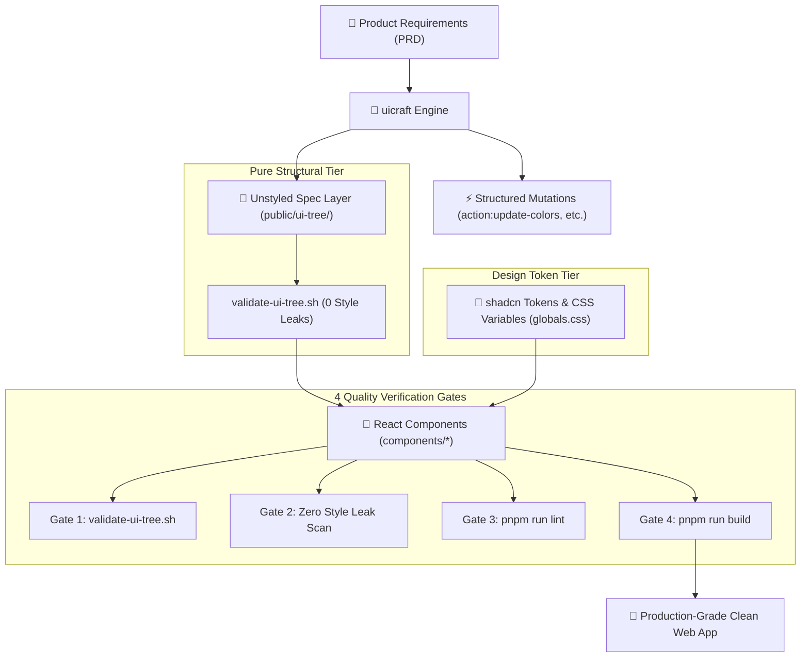

# 🎨 `uicraft`: Autonomous UI/UX Architecture Framework for AI Coding Agents

[](https://skills.sh)
[](https://opensource.org/licenses/MIT)
[](https://ui.shadcn.com)
[](https://skills.sh)

> **`uicraft`** is an open-source architectural meta-framework that transforms how AI coding assistants design and build web applications. It enforces an unstyled, specification-first UI/UX methodology, strictly separates structural information architecture from visual design tokens, and guarantees zero style leaks through automated quality gates.

---

## ⚡ 1-Command Installation

Install `uicraft` into your agent workspace (Antigravity IDE, Claude Code, Cursor, Codex, Windsurf, Amp, or Cline) with a single command:

```bash
npx skills add aicosmo1/uicraft
```

To install globally for all user projects:
```bash
npx skills add aicosmo1/uicraft -g
```

---

## 🛑 The Problem with Agent-Generated UIs

When AI coding agents generate frontends today, they suffer from three universal pitfalls:
1. **Style Leaks & Hallucinated Colors:** Agents inject ad-hoc hex codes (`#3b82f6`) and arbitrary Tailwind utility classes (`bg-blue-600`) scattered across dozens of component files.
2. **Coupled UX & Styling:** Changing a color palette or brand theme breaks structural layouts because visual styling is tightly entangled with information architecture.
3. **Verbose, AI-Fluff Microcopy:** Interfaces get littered with long-winded paragraphs, generic card descriptions, and uninspiring empty states.

---

## 💡 The `uicraft` Solution

`uicraft` decouples UI engineering into two clean, independent tiers:



1. **Unstyled UI Trees (`public/ui-tree/`)**: Every component is specified in markdown before any JSX is written. Specs define information hierarchy, state machines, props, and requirement IDs with **zero hardcoded colors**.
2. **Pure Token Binding**: All visual design is delegated to **`shadcn/ui` presets** and semantic CSS variables (`--primary`, `--card`, `--border`, `--foreground`). Swapping an entire brand identity takes 30 seconds by updating CSS variables without touching component markup.
3. **Structured Mutation Actions**: Perform atomic updates to running applications using formal actions (`action:update-colors`, `action:modify-component`, `action:update-philosophy`, `action:update-technicals`, `action:build-code`).
4. **Automated Quality Gates**: Built-in verification scripts enforce spec traceability, run zero-style-leak regex scanners, verify linting, and compile production bundles.

---

## 📦 What's Inside

```
uicraft/
├── SKILL.md                    # Core agent skill instructions (Agent Skills Standard)
├── config.template.json        # Foundational config template for target apps
├── bundled-skills/             # Native bundled skills
│   └── ui-copywriting/         # Concise human-crafted microcopy & anti-AI tone rules
├── references/                 # Deep-dive architecture references
│   ├── action-workflow.md      # Mutation lifecycle & rollback rules
│   ├── actions-catalog.md      # Catalog of all formal actions
│   ├── component-schema.md     # Component spec standard & frontmatter
│   ├── evaluation-rubric.md    # Architecture audit scorecard
│   ├── philosophy-extraction.md# Brand philosophy & design language rules
│   ├── shadcn-integration.md   # Official shadcn integration & preset mapping
│   ├── technicals-specification.md # Engineering constraints & state architecture
│   ├── tree-specification.md   # UI tree decomposition methodology
│   └── integrations/
│       ├── registry.md         # Partner Skills Master Catalog
│       └── ui-copywriting.md   # Microcopy integration guide
└── scripts/                    # Portable quality verification engines
    ├── eval-app.sh             # 4-Gate full-app compliance evaluation
    ├── install-integrations.sh # Autonomous partner skill synchronizer
    └── validate-ui-tree.sh     # Spec validator & style leak scanner
```

---

## 🤝 Partner Skills Ecosystem

`uicraft` natively collaborates with leading agent skills across the open ecosystem:

### 1. Bundled Native Skills
- **`ui-copywriting`** *(Self-contained)*: Enforces human-crafted microcopy standards (headings $\le 4$ words, subtitles $\le 12$ words, front-loaded active verbs, 2-sentence empty states).

### 2. External Ecosystem Integrations
- **`shadcn`** ([`shadcn-ui/ui@shadcn`](https://github.com/shadcn-ui/ui)): Visual presets, Radix primitives, typography.
- **`web-design-guidelines`** ([`vercel-labs/agent-skills@web-design-guidelines`](https://github.com/vercel-labs/agent-skills)): A11y, WCAG contrast, touch targets.
- **`better-layout`** ([`jakubkrehel/skills/skills/better-layout`](https://skills.sh)): Spatial hierarchy, shared edges, baseline alignment.
- **`responsive-design`** ([`wshobson/agents/plugins/ui-design/skills/responsive-design`](https://skills.sh)): Container queries, fluid typography, mobile-first breakpoints.
- **`composition-patterns`** ([`vercel-labs/agent-skills@composition-patterns`](https://github.com/vercel-labs/agent-skills)): Compound components, render props.
- **`webperf`** ([`addyosmani/agent-skills@webperf`](https://github.com/addyosmani/agent-skills)): Core Web Vitals, performance budgets.

To automatically audit and sync partner skills into your project:
```bash
bash .agents/skills/uicraft/scripts/install-integrations.sh
```

---

## 🛡️ The 4 Quality Verification Gates

Run the automated evaluator against any target application:

```bash
bash .agents/skills/uicraft/scripts/eval-app.sh <project_directory>
```

| Gate | Purpose | Standard |
| :--- | :--- | :--- |
| **Gate 1: Specification Integrity** | Audits `public/ui-tree/` | All components trace back to PRD; zero hex codes in markdown |
| **Gate 2: Zero Style Leaks** | Scans application source | Zero inline hex codes (`#[0-9a-f]{3,6}`) and zero hardcoded palette classes |
| **Gate 3: Static Analysis Gate** | Runs `pnpm run lint` | Zero ESLint errors or warnings |
| **Gate 4: Compilation Gate** | Runs `pnpm run build` | Zero compilation or TypeScript build errors |

---

## 🚀 Quick Usage in Your AI Agent

Once installed, simply prompt your AI coding assistant:

> *"Use `uicraft` to build the frontend for this PRD. First establish the unstyled UX Tree in `public/ui-tree/`, run `validate-ui-tree.sh`, and then implement the components using shadcn tokens."*

Or to update styling and component structure without touching logic:

> *"Execute `action:update-colors` using this palette: Gunmetal `#393e41`, Dust Grey `#d3d0cb`, Tuscan Sun `#e7bb41`."*

---

## 📄 License

MIT © [Ali Ahmad](https://github.com/aicosmo1)
