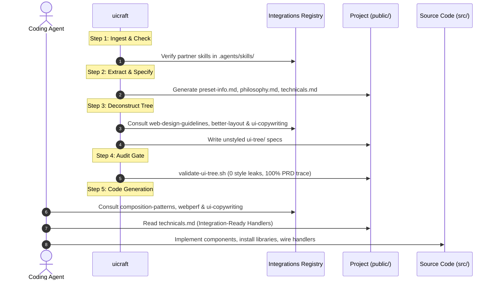

# `uicraft`: Integrations Skill Registry

`uicraft` operates as an open UX & architectural orchestrator. Rather than duplicating existing industry guidelines or hardcoding external rules, `uicraft` integrates with official and community **Agent Skills** managed via the `skills` CLI ecosystem (`npx skills add`).

---

## 1. Architectural Philosophy: Reference Over Duplication

1. **Self-Contained Modularity:** Partner skills live in `.agents/skills/<skill-name>/` with their own `SKILL.md` definitions, references, and scripts.
2. **Zero Bloat:** `uicraft` maintains **boundary contracts** and references to these skills. When a task requires performance budgets, accessibility audits, or compound component patterns, the agent dynamically consults the corresponding installed skill.
3. **Autonomous Presence:** `uicraft` includes an automated check script [`install-integrations.sh`](../../scripts/install-integrations.sh). If any registered partner skill is not yet installed in `.agents/skills/`, `uicraft` can autonomously install it using `npx skills add`.

---

## 2. Master Integrations Catalog

### A. External Ecosystem Skills (Installed via `npx skills add`)
| Partner Skill | Package Spec / Origin | Focus & Rule Enforcement | Dedicated Guide |
| :--- | :--- | :--- | :--- |
| **`shadcn`** | [`shadcn-ui/ui@shadcn`](https://github.com/shadcn-ui/ui) | Visual presets (`--preset`), base color tokens, Base UI / Radix primitives, typography. | [shadcn.md](./shadcn.md) |
| **`webperf`** | [`addyosmani/agent-skills@webperf`](https://github.com/addyosmani/agent-skills) | Core Web Vitals (LCP, INP, CLS), zero layout shifts, lazy loading drawers, hydration optimization. | [web-performance.md](./web-performance.md) |
| **`agent-skills`** | [`addyosmani/agent-skills`](https://github.com/addyosmani/agent-skills) | Spec-driven engineering (`/spec`), code quality reviews (`/review`), architecture cleanliness. | [engineering-suite.md](./engineering-suite.md) |
| **`web-design-guidelines`** | [`vercel-labs/agent-skills@web-design-guidelines`](https://github.com/vercel-labs/agent-skills) | Accessibility (WCAG AA), minimum 44px tap targets, focus trapping, screen-reader semantics. | [web-design-guidelines.md](./web-design-guidelines.md) |
| **`better-layout`** | [`jakubkrehel/skills@better-layout`](https://github.com/jakubkrehel/skills) | Unstyled spatial grouping, shared-edge alignment, 2x spacing ratio, optical baseline harmony, control clearance. | [layout-and-alignment.md](./layout-and-alignment.md) |
| **`responsive-design`** | [`wshobson/agents@responsive-design`](https://github.com/wshobson/agents) | Container queries (`@container`), fluid grid math (auto-fit/minmax), flex blowout prevention, progressive disclosure. | [responsive-design.md](./responsive-design.md) |
| **`composition-patterns`** | [`vercel-labs/agent-skills@composition-patterns`](https://github.com/vercel-labs/agent-skills) | Advanced React compound components, flexible layouts, avoiding prop drilling, slot patterns. | [composition-patterns.md](./composition-patterns.md) |
| **`vercel-react-view-transitions`** | [`vercel-labs/agent-skills@vercel-react-view-transitions`](https://github.com/vercel-labs/agent-skills) | Fluid page transitions, shared layout morphing, navigation animations. | [view-transitions.md](./view-transitions.md) |

### B. Bundled Native Skills (Self-Contained inside `uicraft/bundled-skills/`)
| Bundled Skill | Internal Location | Focus & Rule Enforcement | Dedicated Guide |
| :--- | :--- | :--- | :--- |
| **`ui-copywriting`** | `uicraft/bundled-skills/ui-copywriting` | Human-crafted UI microcopy, concise headings ($\le$ 4 words), subtitles ($\le$ 12 words), zero AI fluff, front-loaded action verbs. | [ui-copywriting.md](./ui-copywriting.md) |

---

## 3. Autonomous Skill Verification & Installation

To check status or synchronize partner skills, run:

```bash
# Dry run to see status:
bash .agents/skills/uicraft/scripts/install-integrations.sh --dry-run

# Autonomous synchronization:
bash .agents/skills/uicraft/scripts/install-integrations.sh
```

- **Bundled Skills (`ui-copywriting`):** Automatically verified and linked from `uicraft/bundled-skills/` with zero network calls.
- **External Skills:** Installed automatically using `npx skills add <package_spec> -y` if not already installed.

---

## 4. How `uicraft` Consults Partner Skills Across the 5 Steps



1. **In Step 1 (Ingest):** Runs `install-integrations.sh` to ensure all necessary skills are present.
2. **In Step 2 (Extract):** Leverages `shadcn` for preset styles and writes `public/technicals.md` for backend/library dependencies.
3. **In Step 3 (Tree Deconstruction):** Uses `web-design-guidelines`, `better-layout`, `responsive-design`, and `ui-copywriting` to dictate accessible structures, minimum tap targets, 2x negative space hierarchy, responsive disclosure boundaries, and concise, fluff-free headings/subtitles without leaking styles.
4. **In Step 5 (Code Generation):** Uses `better-layout` for optical baseline alignment and shared-edge insets, `responsive-design` for container queries (`@container`) and intrinsic fluid grid tracks, `ui-copywriting` for punchy action-first button labels, short telemetry descriptions, and two-sentence empty states, `webperf` to avoid layout shifts, and `composition-patterns` for robust component architecture.
