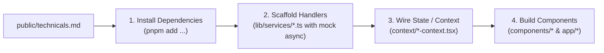

# `uicraft`: Integration-Ready Technicals Specification (`technicals.md`)

## 1. Overview & Strategic Role

When `uicraft` translates an unstyled PRD (`requirements.md`) into a project architecture, it produces three foundational documents in `public/`:
1. [`preset-info.md`](./philosophy-extraction.md): The visual design tokens, base color, and geometry (delegated to shadcn presets).
2. [`philosophy.md`](./philosophy-extraction.md): The UX density, typography rhythm, and interaction standards.
3. **`technicals.md`**: The **Integration-Ready Technical Architecture** detailing external libraries, domain data contracts, and backend service handlers.

---

## 2. The "Integration-Ready" Architecture

### The Core Problem
Often, frontend code generated by coding agents hardcodes state directly inside JSX buttons or components. When the engineering team later connects a real database (e.g., Supabase, Prisma, Firebase, or an internal REST/gRPC API), they must refactor the entire UI layer, rewrite forms, and rewire callbacks.

### The `uicraft` Solution: Integration-Ready from Day One
`uicraft` mandates that Step 5 code generation produces an **Integration-Ready frontend**:
1. **Typed Service Handlers (`lib/services/*` or `lib/api/*`):** All data operations (fetch, create, update, delete, test ping) are defined as clean async functions with realistic TypeScript signatures.
2. **Complete UI State Wiring:** Components, tables, forms, and modals bind exclusively to these service handlers. Loading indicators, error banners, and optimistic visual feedback are fully built into the UI.
3. **Zero UI Refactoring:** When the real backend is connected, developers or backend agents only configure environment variables and implement the internal logic of the service handlers. **The UI requires zero modifications.**

---

## 3. Required Structure of `public/technicals.md`

Every `public/technicals.md` generated in Step 2 must follow this exact standard schema:

### Section 1: Required Libraries & Installation Commands
Lists all non-UI packages needed to satisfy the PRD requirements (e.g., BaaS SDKs, data validation, utilities):
```markdown
## 1. Required Packages & Dependencies
Run the following package manager command to install necessary libraries:
```bash
pnpm add @supabase/supabase-js zod date-fns lucide-react
```
```

### Section 2: Backend Architecture & Service Mapping
Identifies backend systems mentioned or implied by `requirements.md`:
- **Database / BaaS:** (e.g. Supabase, PostgreSQL, Prisma, MongoDB)
- **Authentication:** (e.g. Supabase Auth, Clerk, NextAuth)
- **External APIs & Gateways:** (e.g. Stripe, AWS S3, Resend)
- **Real-Time / Webhooks:** (e.g. Webhook signature verification, WebSockets)

### Section 3: Domain Data Contracts (TypeScript Interfaces)
Specifies unambiguous data models representing backend records:
```typescript
export interface ApiKeyRecord {
  id: string
  name: string
  token_hash: string
  environment: "Production" | "Staging"
  created_at: string
  last_used_at: string | null
  is_revoked: boolean
}
```

### Section 4: Service Handlers Blueprint
Prescribes the exact file paths and function signatures for data handlers:
```markdown
## 4. Service Handlers Blueprint (`lib/services/`)
- `lib/services/api-keys.ts`:
  - `fetchApiKeys(env?: string): Promise<ApiKeyRecord[]>`
  - `generateApiKey(data: CreateKeyInput): Promise<ApiKeyRecord>`
  - `revokeApiKey(id: string): Promise<{ success: boolean }>`
- `lib/services/webhooks.ts`:
  - `fetchWebhookEndpoints(): Promise<WebhookEndpoint[]>`
  - `testPingWebhook(id: string): Promise<{ statusCode: number; latencyMs: number }>`
  - `createWebhookEndpoint(data: CreateWebhookInput): Promise<WebhookEndpoint>`
```

### Section 5: Environment Variables Template (`.env.example`)
Specifies the environment keys required for real integration:
```bash
# Backend Credentials Template
NEXT_PUBLIC_SUPABASE_URL=https://your-project.supabase.co
NEXT_PUBLIC_SUPABASE_ANON_KEY=your-anon-key
SUPABASE_SERVICE_ROLE_KEY=your-service-role-key
```

---

## 4. Step 5 Execution Workflow for Coding Agents

When generating code in Step 5, the coding agent follows this integration contract:



1. **Install Dependencies:** Executes the package install command from Section 1 of `technicals.md`.
2. **Scaffold Service Handlers:** Creates `lib/services/` (or `lib/api/`) implementing the exact function signatures from Section 4. Initial implementations return realistic mock data with simulated network latency (`await new Promise(r => setTimeout(r, 200))`).
3. **Wire Context & State:** Central state providers consume the service handlers rather than embedding static inline arrays.
4. **Build UI Components:** Views and forms call context actions, displaying loading spinners, success toasts, and error alerts.

**Outcome:** The application is visually stunning, fully interactive, and 100% ready for backend deployment.
